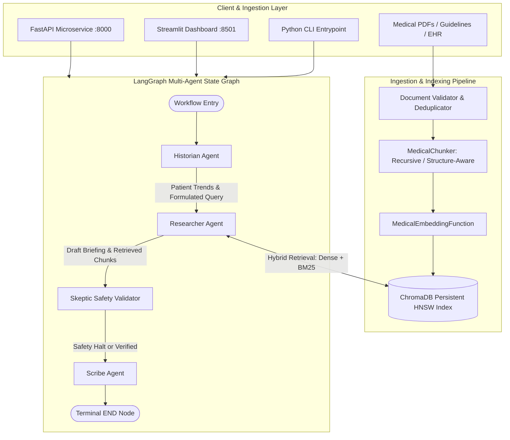
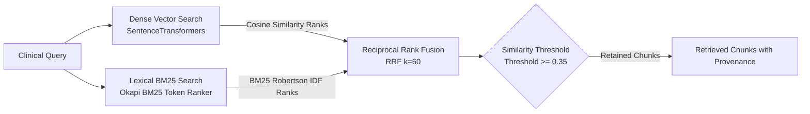

# System Architecture & Technical Design

This document details the software architecture, state machine semantics, retrieval engineering, and safety guardrails of **Agentic Medical RAG**.

---

## 1. High-Level Target Architecture

The platform operates as a Clinical Decision Support (CDS) engine combining hybrid vector retrieval with a multi-agent LangGraph state machine.



---

## 2. Multi-Agent Responsibilities & Contracts

| Agent | Responsibility | Inputs | Outputs | Failure Boundary |
|---|---|---|---|---|
| **Historian** | Parses clinical narratives and EHR notes; detects longitudinal lab trends (Creatinine, HbA1c, BP); checks history for anatomical contraindications (e.g. Renal Artery Stenosis). | `patient_id`, `patient_history` | `clinical_trends`, `query` | Gracefully falls back to baseline patient state if EHR notes are unreadable. |
| **Researcher** | Executes adaptive hybrid retrieval (ChromaDB dense k-NN + Okapi BM25 lexical fusion); formats retrieved guidelines; generates draft clinical briefing. | `query`, `clinical_trends` | `retrieved_docs`, `retrieved_chunks`, `draft_briefing` | Flags 0-candidate or low-similarity retrieval for downstream Skeptic evaluation. |
| **Skeptic** | Adversarial safety auditor; detects prompt injection in untrusted inputs; cross-references recommendations against patient contraindications; triggers abstention. | `draft_briefing`, `patient_history`, `query`, `retrieved_chunks` | `verified: bool`, `abstained: bool`, `abstention_reason`, `contradictions`, `safety_flags` | If any contraindication or injection attempt is detected, forces `verified=False`. |
| **Scribe** | Finalizes clinician-facing briefing; validates that all cited claims map to actually retrieved chunk IDs; enforces medical CDS disclaimer. | Full graph state | `final_report`, `citations`, `validated_citations` | In unverified/abstention scenarios, compiles a structured Safety Advisory explaining exact clinical rationales and next steps. |

---

## 3. Explicit LangGraph State Schema (`AgentState`)

```python
class AgentState(TypedDict):
    patient_id: str                          # Patient unique identifier
    patient_history: str                     # Clinical background narrative
    clinical_trends: List[str]               # Detected longitudinal laboratory trends
    query: str                               # Active clinical search query
    retrieved_docs: List[str]                # Retrieved guideline text snippets
    retrieved_chunks: List[Dict[str, Any]]   # Structured chunk provenance (IDs, scores, pages)
    draft_briefing: str                      # Unverified draft briefing
    reasoning: str                           # Audit trace from latest active agent
    verified: bool                           # Safety clearance flag set by Skeptic
    abstained: bool                          # Explicit abstention indicator
    abstention_reason: Optional[str]         # Reason for abstention if triggered
    contradictions: List[str]                # Detected clinical contraindications
    safety_flags: List[str]                  # Security and clinical audit tags
    final_report: str                        # Formatted, citation-grounded final output
    citations: List[str]                     # Human-readable formatted citations
    validated_citations: List[Dict[str, Any]]# Machine-readable chunk mappings
    iteration_count: int                     # Loop prevention counter
    max_iterations: int                      # Maximum execution iterations (default: 5)
```

---

## 4. Retrieval Architecture: Hybrid Dense + Lexical Fusion



### Fusion Algorithm
Reciprocal Rank Fusion (RRF) scores each document $d$:
$$RRF\_Score(d) = \sum_{m \in \{dense, bm25\}} \frac{w_m}{k + \text{rank}_m(d)}$$
where $k = 60$, $w_{dense} = 0.6$, and $w_{bm25} = 0.4$.

---

## 5. Security & Threat Mitigation Boundaries

1. **Untrusted Data Boundary**: All user queries and retrieved document chunks are treated as untrusted data and scanned for prompt injection attacks (`ignore previous instructions`, `DAN`, `reveal system prompt`).
2. **Clinical Safety Boundary**: Skeptic agent explicitly evaluates black-box warnings (e.g. ACEi/ARB in bilateral renal artery stenosis; Metformin in severe CKD).
3. **Citation Integrity Boundary**: Scribe ensures every cited claim maps to a real `chunk_id` in `retrieved_chunks`. The system never fabricates sources.
4. **Offline Resilience**: When `MOCK_LLM=true` or in test environments, deterministic 384-dimensional unit vectors and template briefings enable 100% offline testing without cloud network dependency.
