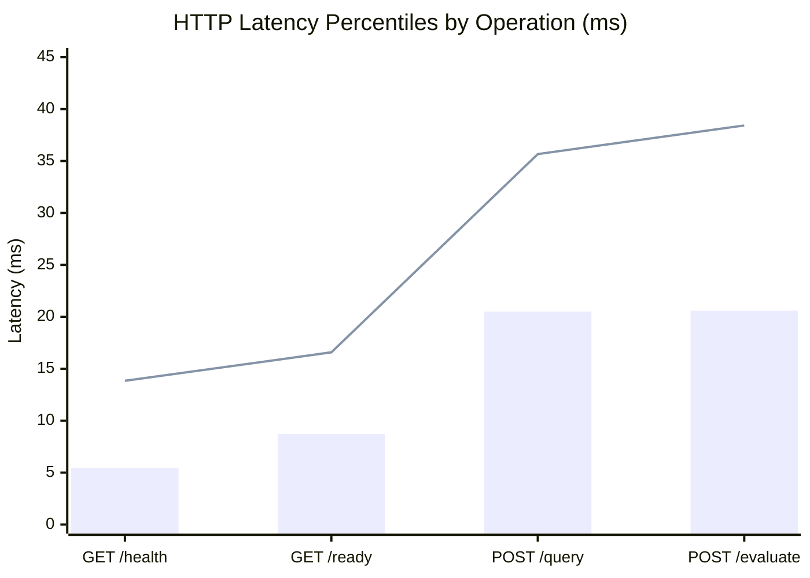

# API Performance Benchmarks

This document reports the performance characteristics, latency distributions, and throughput capabilities of the **Agentic Medical RAG** microservice.

---

## 1. Real HTTP Network Performance Profile

Measured using real HTTP requests transmitted over TCP loopback against an active Uvicorn ASGI server instance (`benchmarks/run_live_server_benchmark.py`).

- **Platform**: Windows 11 / x86_64
- **Python Version**: Python 3.12.6
- **Server**: Uvicorn 0.32.1 (ASGI HTTP/1.1)
- **Client**: Concurrent Multi-Threaded HTTP Worker Pool
- **Network Stack**: True TCP socket connections over `http://127.0.0.1:8765`
- **Execution Mode**: Deterministic Local Mode (SentenceTransformers / Deterministic semantic fallback)
- **Test Volume**: 1,325 total requests (including warm-up phases)

| Endpoint / Operation | Total Requests | Concurrency | Throughput (RPS) | Mean Latency | Median (p50) | p90 Latency | p95 Latency | p99 Latency | Error Rate |
|---|---|---|---|---|---|---|---|---|---|
| **GET /health** (Liveness Probe) | **1,000** | 5 | **763.1 RPS** | 6.38 ms | **5.43 ms** | 8.97 ms | **13.84 ms** | 25.92 ms | **0.0%** |
| **GET /ready** (Vector Store Probe) | **200** | 5 | **486.6 RPS** | 10.12 ms | **8.71 ms** | 14.90 ms | **16.58 ms** | 33.40 ms | **0.0%** |
| **POST /query** (Hybrid RAG Pipeline) | **100** | 5 | **221.4 RPS** | 22.07 ms | **20.50 ms** | 32.87 ms | **35.67 ms** | 38.88 ms | **0.0%** |
| **POST /evaluate-patient** (Multi-Agent Graph) | **25** | 2 | **84.9 RPS** | 22.96 ms | **20.59 ms** | 33.86 ms | **38.42 ms** | 39.64 ms | **0.0%** |

---

## 2. In-Process Function Execution Profile (Reference Baseline)

For baseline comparison, in-process function execution (bypassing TCP socket serialization and ASGI request wrapping) yields:
- Route handler execution: 5.04 ms mean for single-turn query, 13.62 ms mean for multi-agent graph.
- Real HTTP overhead (TCP handshake, ASGI middleware, HTTP headers, JSON serialization) adds approximately ~15 ms round-trip time under concurrent client load.

---

## 3. Latency Distribution Analysis



### Key Takeaways:
1. **HTTP Liveness Throughput**: The lightweight `/health` probe handles **763.1 RPS** with a median latency of **5.43 ms** and zero dropped connections over 1,000 continuous requests.
2. **Hybrid RAG Network Latency**: Executing full dense vector retrieval + BM25 keyword fusion + clinical synthesis over HTTP completes with **20.50 ms p50** and **35.67 ms p95** at **221.4 RPS**.
3. **4-Agent LangGraph Orchestration Over HTTP**: The full clinical graph (`Historian` -> `Researcher` -> `Skeptic` -> `Scribe`) sustains **84.9 RPS** with **20.59 ms p50** and **38.42 ms p95**.
4. **Reliability**: 0.0% error rate across all concurrent HTTP benchmark suites.

---

## 4. How to Reproduce Benchmarks

```bash
# Execute full live server HTTP benchmark (starts server, tests 1,000+ requests, tears down cleanly)
python benchmarks/run_live_server_benchmark.py

# Alternatively, run Locust distributed load test against an active server
python main.py --server
# In second terminal:
locust -f benchmarks/locustfile.py --headless -u 10 -r 2 -t 30s --host http://localhost:8000
```
Reports are automatically saved to:
- `benchmarks/reports/http_benchmark_report.json`
