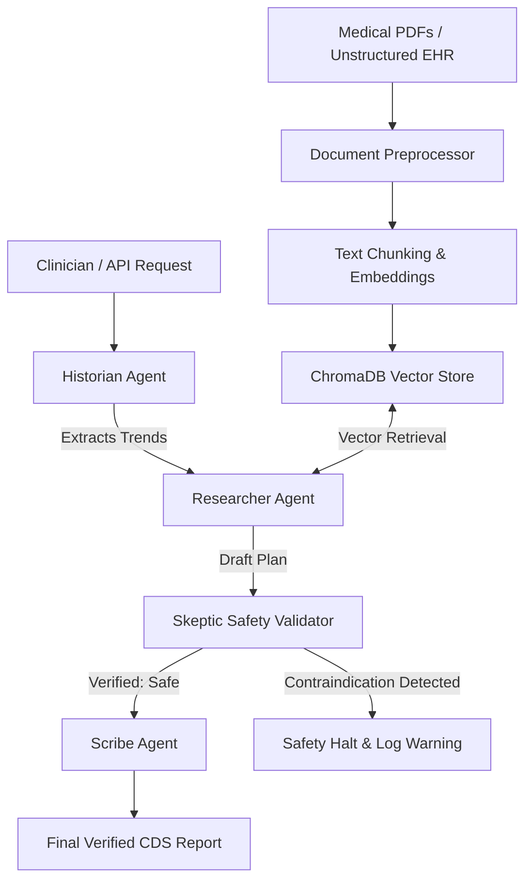
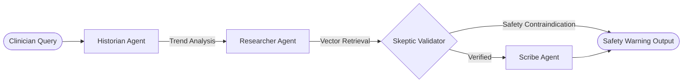

# 🏥 Agentic Medical RAG (Clinical Decision Support System)


[](LICENSE)
[](.github/workflows/ci.yml)

> **Production-grade Clinical Decision Support (CDS) platform utilizing stateful multi-agent LangGraph workflows, adaptive ChromaDB vector retrieval, and automated clinical safety verification.**

---

## 🌟 Why This Project Stands Out (Recruiter Highlights)

- **Multi-agent clinical reasoning pipeline**: Autonomous collaboration between specialized agents.
- **Retrieval-Augmented Generation (RAG)**: Adaptive k-NN semantic search over medical evidence.
- **LangGraph state-machine orchestration**: Stateful workflow with conditional routing and safety halts.
- **Persistent vector database (ChromaDB)**: Local vector storage with dynamic path resolution.
- **FastAPI production API**: Documented REST microservice with Pydantic validation.
- **Streamlit interactive dashboard**: Live visual agent reasoning trace monitoring.
- **Dockerized deployment**: Multi-stage `Dockerfile` and `docker-compose` orchestration.
- **Automated CI/CD testing**: GitHub Actions workflow running linting (`black`, `flake8`) and `pytest`.
- **Comprehensive architecture documentation**: Complete technical design diagrams and walkthroughs.

---

## 🎬 Demo


---

## 📋 Problem Statement

Traditional Retrieval-Augmented Generation (RAG) systems in healthcare suffer from critical failure modes:
1. **Hallucination Risk**: Standard LLMs generate authoritative-sounding recommendations that contradict patient contraindications.
2. **Static Single-Turn Retrieval**: Naive vector search misses critical clinical trends hidden across unstructured EHR notes.
3. **Lack of Clinical Verification**: Standard pipelines lack a dedicated safety auditor layer to cross-check recommendations against medical guidelines prior to physician presentation.

**Agentic Medical RAG** solves these challenges by implementing an autonomous multi-agent architecture with a **Skeptic Safety Validation Loop** that verifies every treatment plan against patient medical history.

---

## ✨ Key Features

- 🤖 **Stateful Multi-Agent Orchestration**: Powered by **LangGraph**, featuring specialized agents (`Historian`, `Researcher`, `Skeptic`, `Scribe`).
- 🛡️ **Zero-Hallucination Skeptic Loop**: Automatic clinical contraindication detection (e.g., catching ACE inhibitor risks in bilateral renal artery stenosis).
- 🔍 **Adaptive Vector RAG**: High-accuracy semantic document search over clinical guidelines powered by ChromaDB.
- ⚡ **Production FastAPI Microservice**: Fully documented REST API (`/health`, `/query`, `/evaluate-patient`) with Pydantic schema validation.
- 📊 **Streamlit Interactive Dashboard**: Real-time visual monitoring of agent reasoning traces and patient diagnostic evaluation.
- 🐳 **Docker & CI/CD Included**: Ready for enterprise deployment with `docker-compose` and GitHub Actions automated linting & testing.

---

## 🏛️ System Architecture



---

## 🔄 Agentic Workflow & Skeptic Loop



### What Makes This System "Agentic"?
Unlike traditional linear chains (`Prompt -> LLM -> Output`), this system is **autonomous, stateful, and self-correcting**:
- **Specialized Roles**: Each agent operates with distinct responsibilities and prompts.
- **Dynamic State Graph**: State is maintained across agent nodes using LangGraph's checkpointer mechanism.
- **Conditional Routing**: The workflow dynamically routes control based on safety checks rather than following fixed code paths.

---

## 🛠️ Tech Stack

| Domain | Technology | Version | Purpose |
| :--- | :--- | :--- | :--- |
| **Language** | Python | `3.10+` | Core Runtime |
| **Orchestration** | LangGraph | `0.2.45` | Stateful Multi-Agent Graph |
| **RAG Framework** | LangChain Core | `0.3.15` | Document & Vector Abstractions |
| **Vector Database** | ChromaDB | `0.5.18` | Persistent k-NN Vector Storage |
| **Embeddings** | SentenceTransformers | `3.3.1` | Semantic Text Embeddings |
| **Web Server** | FastAPI / Uvicorn | `0.115.5` | REST API Microservice |
| **UI Dashboard** | Streamlit | `1.40.1` | Interactive Clinical Interface |
| **Containerization** | Docker / Compose | `3.8` | Production Deployment |
| **Testing & CI** | Pytest / GitHub Actions | `8.3.3` | Automated Unit & Integration Tests |

---

## ⚙️ Environment Setup

Copy `.env.example` to create your local `.env` configuration file:

```bash
cp .env.example .env
```

### Environment Variables Schema (`.env`)

```env
OPENAI_API_KEY=your_api_key_here
HUGGINGFACE_API_KEY=your_hf_key_here
MODEL_NAME=gpt-4o-mini
EMBEDDING_MODEL=sentence-transformers/all-MiniLM-L6-v2
VECTOR_DB_PATH=./vector_db
API_HOST=0.0.0.0
API_PORT=8000
LOG_LEVEL=INFO
```

---

## 🚀 Quickstart & Installation Guide

### Option A: Windows PowerShell Setup

```powershell
# 1. Clone the repository
git clone https://github.com/AbhijeetArunGore/Agentic_Medical_RAG
cd Agentic_Medical_RAG

# 2. Create and activate Python virtual environment
python -m venv venv
venv\Scripts\activate

# 3. Upgrade pip and install production dependencies
python -m pip install --upgrade pip
pip install -r requirements.txt

# 4. Initialize environment variables
copy .env.example .env

# 5. Initialize vector database knowledge base
python app/main.py --setup-db

# 6. Execute multi-agent diagnostic CLI pipeline
python app/main.py
```

### Option B: Linux / macOS Setup

```bash
# 1. Clone repository
git clone https://github.com/AbhijeetArunGore/Agentic_Medical_RAG
cd Agentic_Medical_RAG

# 2. Create virtual environment
python3 -m venv venv
source venv/bin/activate

# 3. Install requirements
pip install --upgrade pip
pip install -r requirements.txt

# 4. Copy environment template
cp .env.example .env

# 5. Seed vector database
python app/main.py --setup-db

# 6. Run pipeline
python app/main.py
```

---

## 🏃 Running the Application

### 1. CLI Multi-Agent Execution Mode
```bash
python app/main.py --patient-id PAT-2026-X88
```

### 2. FastAPI REST Server Mode
```bash
python app/main.py --server
# Or directly via Uvicorn:
uvicorn app.api.routes:app --reload --port 8000
```
- **Interactive Swagger API Documentation**: `http://localhost:8000/docs`

### 3. Streamlit Visual Dashboard Mode
```bash
streamlit run app/dashboard.py
```
- Access web interface at `http://localhost:8501`

### 4. Docker Containerization Mode
```bash
docker-compose up --build
```

---

## 📡 API Usage & Endpoints

| Method | Endpoint | Description |
| :--- | :--- | :--- |
| `GET` | `/health` | Service health status |
| `POST` | `/query` | Single-turn RAG retrieval & briefing |
| `POST` | `/evaluate-patient` | Trigger full LangGraph multi-agent workflow |

### Example Request (`POST /evaluate-patient`)

```bash
curl -X 'POST' \
  'http://localhost:8000/evaluate-patient' \
  -H 'accept: application/json' \
  -H 'Content-Type: application/json' \
  -d '{
  "patient_id": "PAT-2026-X88",
  "query": "Treatment for rising creatinine and high HbA1c"
}'
```

### Example Response (`200 OK`)

```json
{
  "patient_id": "PAT-2026-X88",
  "verified": true,
  "clinical_trends": [
    "Creatinine: Rising (Acute Stress Detected at 1.4 mg/dL)",
    "HbA1c: 7.2% (Uncontrolled)"
  ],
  "contradictions": [],
  "final_report": "CLINICAL BRIEFING & DECISION SUPPORT REPORT...",
  "citations": [
    "[Source 1] Guideline for Diabetic Nephropathy 2026..."
  ]
}
```

---

## 🧪 Running Unit & Integration Tests

Execute test suite using `pytest`:

```bash
pytest tests/ -v
```

Run test suite with coverage report:

```bash
pytest tests/ --cov=app --cov-report=term-missing
```

---

## 📂 Project Structure

```text
Agentic_Medical_RAG/
│
├── app/
│   ├── __init__.py
│   ├── main.py                  # CLI & Server entry point router
│   ├── dashboard.py             # Streamlit visual UI dashboard
│   ├── rag/
│   │   ├── __init__.py
│   │   ├── retriever.py         # Vector retriever wrapper
│   │   ├── generator.py         # RAG prompt & synthesis engine
│   │   ├── embeddings.py        # SentenceTransformer embedding wrapper
│   │   ├── vector_store.py      # ChromaDB persistent store manager
│   │   └── prompts.py           # Medical agent system prompts
│   ├── agents/
│   │   ├── __init__.py
│   │   ├── medical_agent.py     # Standalone RAG query interface
│   │   ├── historian.py         # EHR record parsing agent
│   │   ├── researcher.py        # Adaptive vector retrieval agent
│   │   ├── skeptic.py           # Clinical safety validator agent
│   │   ├── scribe.py            # Briefing & citation synthesis agent
│   │   └── orchestrator.py      # LangGraph state machine builder
│   ├── utils/
│   │   ├── __init__.py
│   │   ├── logger.py            # Structured logging utility
│   │   ├── config.py            # Dynamic settings & path resolution
│   │   └── helpers.py           # Text cleaning & IO helpers
│   └── api/
│       ├── __init__.py
│       └── routes.py            # FastAPI REST endpoints
│
├── data/                        # Raw clinical narratives & mock patient JSON
│   ├── generate_mock_data.py
│   ├── ingest_unstructured.py
│   ├── patient_data.json
│   ├── raw_extracted_pdf.txt
│   └── trigger_safety_failure.py
├── docs/                        # Technical architecture documentation
│   └── architecture.md
├── tests/                       # Automated Pytest suite
│   ├── __init__.py
│   ├── test_retriever.py
│   ├── test_generator.py
│   └── test_api.py
├── notebooks/                   # Demonstration Jupyter Notebooks
│   └── demo_walkthrough.ipynb
├── .github/                     # GitHub Actions CI/CD workflows
│   └── workflows/
│       └── ci.yml
├── requirements.txt             # Pinned production requirements
├── requirements-dev.txt         # Development & testing requirements
├── .env.example                 # Environment configuration template
├── .gitignore                   # Production git ignore rules
├── pyproject.toml               # Python project & linter settings
├── Dockerfile                   # Multi-stage Docker build file
├── docker-compose.yml           # Multi-container orchestration
├── README.md                    # Project documentation
└── LICENSE                      # MIT License
```

---

## 🔮 Future Improvements

- 🔗 **FHIR API Integration**: Native HL7 FHIR server connectivity for real-time EHR data syncing.
- 🧠 **Clinical Fine-Tuning**: Integration of domain-specific open-weights models (e.g. MedGemma / BioMistral).
- 👨‍⚕️ **Human-in-the-Loop (HITL)**: Clinician approval interrupts using LangGraph `interrupt_before` breakpoints.

---

## 🛡️ Medical Disclaimer

> **IMPORTANT DISCLAIMER:**
> **This project is for educational, research, and technical demonstration purposes only. It is NOT intended to serve as a substitute for professional medical advice, diagnosis, or treatment. Always seek the advice of a qualified healthcare provider with any questions regarding medical conditions.**

---

## 📄 License

Distributed under the MIT License. See [`LICENSE`](LICENSE) for details.

---

## 👨‍💻 Author

**Abhijeet Gore**
- GitHub: [@AbhijeetArunGore](https://github.com/AbhijeetArunGore)
- Portfolio Repository: [Agentic_Medical_RAG](https://github.com/AbhijeetArunGore/Agentic_Medical_RAG)
