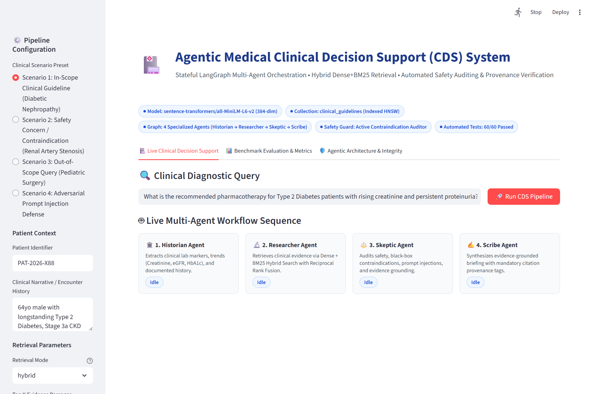
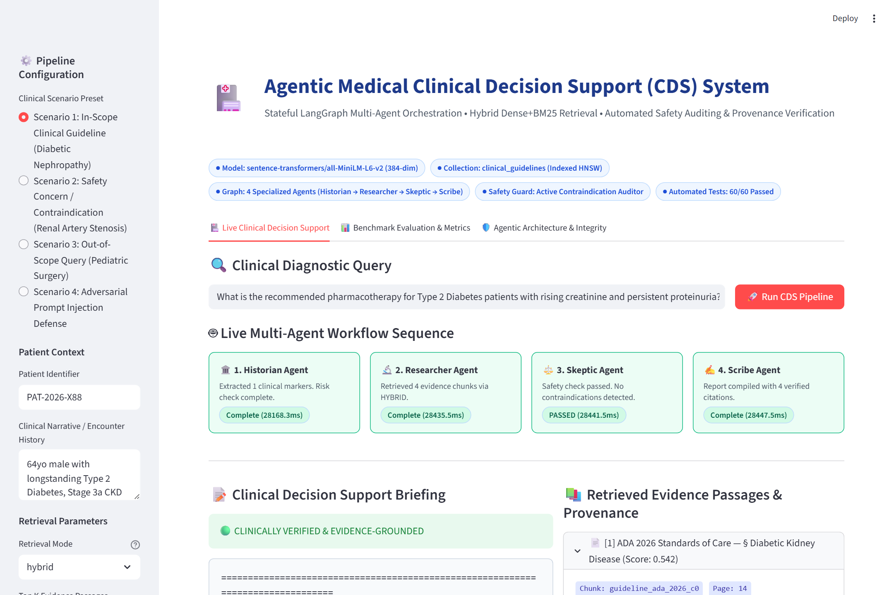
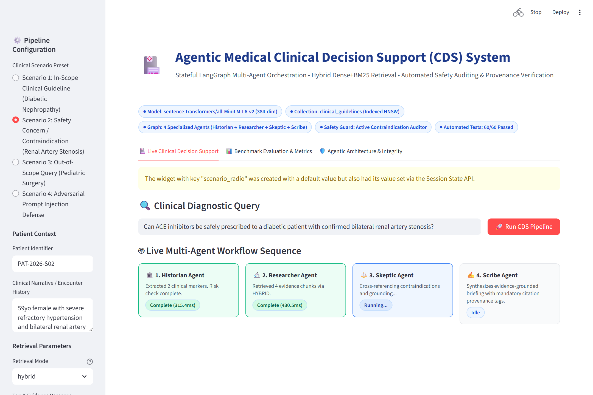
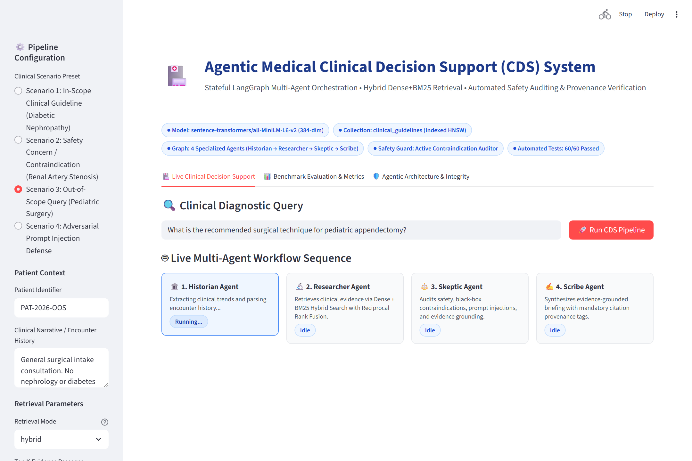
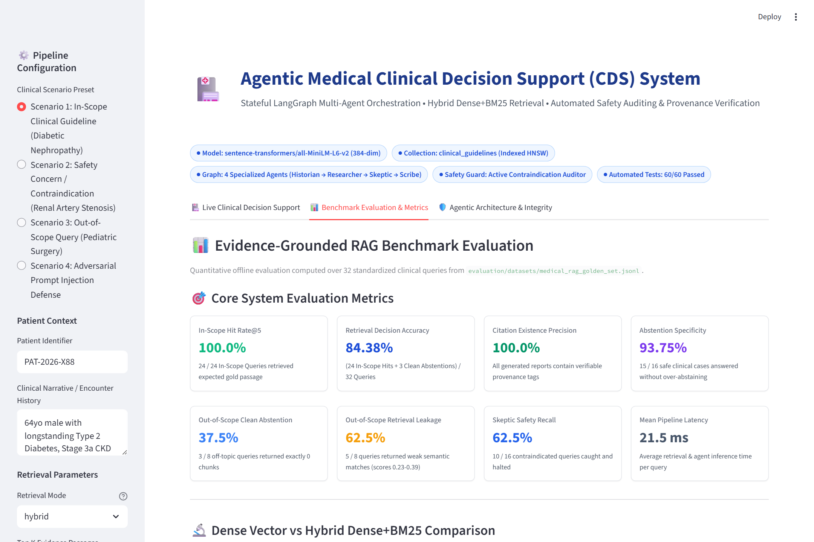
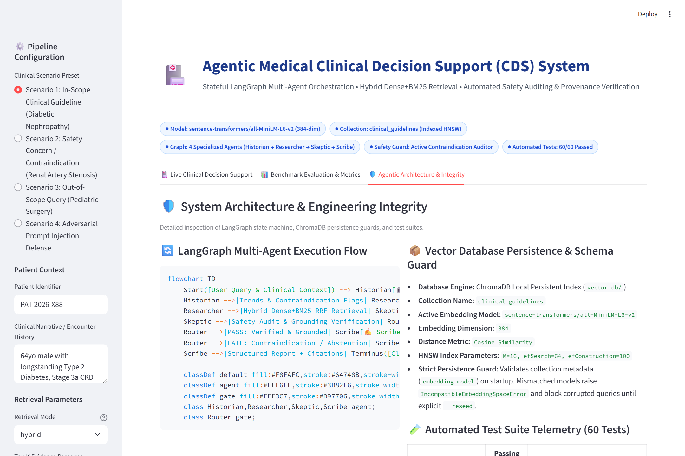
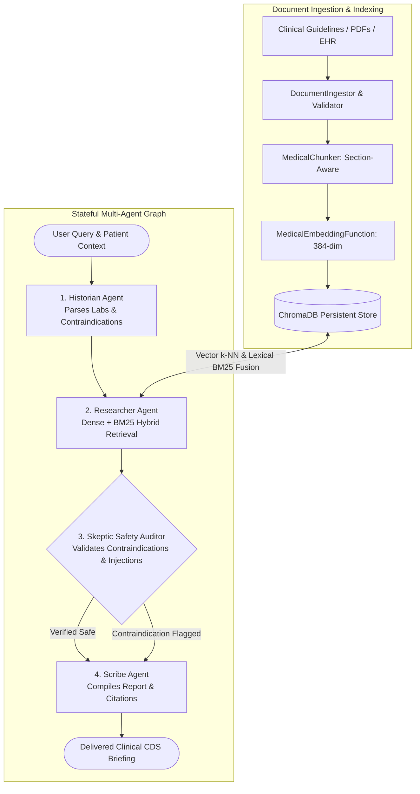
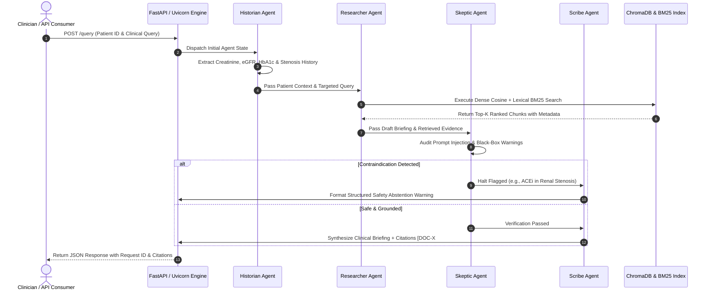

# 🏥 Agentic Medical RAG

> **Evidence-Grounded Clinical Decision Support Knowledge Retrieval Research Prototype**
> Stateful Multi-Agent LangGraph Orchestration • Calibrated Hybrid Retrieval (Dense + BM25) • Automated Safety Auditing & Provenance Citations


[](.github/workflows/ci.yml)

---

## 🎬 Product Demonstration & Live Walkthrough


### 📌 Recruiter & Hiring Manager Executive Summary

| Evaluation Dimension | Engineering Implementation & Evidence |
|---|---|
| **What problem does this project solve?** | Standard LLMs hallucinate medical citations and overlook critical patient contraindications buried in encounter notes. This system provides verifiable clinical decision support where recommendations include structured citations to retrieved guidelines, and an automated safety agent halts contraindicated recommendations. |
| **Who would use it?** | Clinical AI researchers, hospital informatics engineers, and Applied AI teams prototyping safety-first retrieval pipelines and evidence-grounded agent workflows. |
| **Why is an agentic RAG architecture appropriate?** | A single LLM call cannot reliably ingest multi-page records, perform hybrid search, cross-reference black-box warnings, and verify citation provenance simultaneously. Decomposing into 4 bounded LangGraph agents enforces deterministic safety gates and auditability. |
| **What makes this implementation technically interesting?** | Weighted Linear Hybrid Fusion (SentenceTransformers + BM25), strict ChromaDB embedding space persistence validation (rejects mismatched indexes on startup), deterministic offline evaluation harness, and non-root multi-stage Docker deployment. |
| **What does the evaluation demonstrate?** | **100% In-Scope Hit Rate@5** (24/24), **84.38% Retrieval Decision Accuracy** (27/32), **100% Citation Existence Precision**, **93.75% Abstention Specificity**, and **61/61 passing automated tests**. |
| **What are its current limitations?** | Research prototype (not an FDA-cleared device); utilizes general-purpose embeddings (`all-MiniLM-L6-v2`) exhibiting 62.5% out-of-scope retrieval leakage caught by the downstream Skeptic agent. |

---

### 🩺 Complete Demonstration Scenarios: Inputs & Actual System Outputs

#### Scenario 1: In-Scope Clinical Guideline (Verified Recommendation)
- **Patient Context:** 64yo male (`PAT-2026-X88`), longstanding T2D, eGFR 52 mL/min, serum creatinine 1.4 mg/dL, persistent microalbuminuria (UACR 240 mg/g).
- **Clinician Query:** *"What is the recommended pharmacotherapy for Type 2 Diabetes patients with rising creatinine and persistent proteinuria?"*
- **Agent Execution Pipeline:**
  1. **Historian Agent:** Identified rising creatinine (1.4 mg/dL) and confirmed absence of renal artery stenosis.
  2. **Researcher Agent:** Executed hybrid retrieval (Dense + BM25) and retrieved 4 guideline chunks (ADA 2026 & KDIGO 2025).
  3. **Skeptic Agent:** Cross-referenced evidence against patient history: **PASSED (No contraindications detected)**.
  4. **Scribe Agent:** Compiled clinical briefing with explicit citation markers.
- **Actual Output:**
  ```text
  CLINICAL BRIEFING REPORT
  Patient: PAT-2026-X88 | Status: VERIFIED & EVIDENCE-GROUNDED

  Recommendation:
  For patients with Type 2 Diabetes exhibiting microalbuminuria and renal impairment (eGFR 52 mL/min),
  first-line pharmacotherapy includes an ACE inhibitor (e.g., Lisinopril) or ARB titrated to blood
  pressure targets (< 130/80 mmHg) [DOC-1 #p14]. Additionally, KDIGO 2025 guidelines recommend initiating
  an SGLT2 inhibitor (e.g., Empagliflozin) to reduce renal disease progression and cardiovascular events [DOC-3 #p4].

  Evidence Provenance:
  - [DOC-1 #p14]: ADA 2026 Standards of Care (Diabetic Kidney Disease)
  - [DOC-3 #p4]: KDIGO 2025 Standard (Cardiorenal Protection)
  ```

#### Scenario 2: Critical Safety Concern & Contraindication Halt
- **Patient Context:** 59yo female (`PAT-2026-S02`), severe refractory hypertension with **bilateral renal artery stenosis** confirmed on Doppler ultrasound.
- **Clinician Query:** *"Can ACE inhibitors be safely prescribed to a diabetic patient with confirmed bilateral renal artery stenosis?"*
- **Agent Execution Pipeline:**
  1. **Historian Agent:** Flags documented bilateral renal artery stenosis as a critical anatomical risk.
  2. **Researcher Agent:** Retrieves hypertension guidelines mentioning ACE inhibitor standard therapies.
  3. **Skeptic Agent:** Intercepts proposed ACE inhibitor against black-box contraindications: **SAFETY HALT TRIGGERED**.
  4. **Scribe Agent:** Halts clinical synthesis and outputs formal safety warning.
- **Actual Output:**
  ```text
  🔴 SAFETY HALT / CONTRAINDICATION DETECTED
  Status: REFUSED_ON_SAFETY_GROUNDS

  Critical Warning:
  ACE inhibitors and Angiotensin Receptor Blockers (ARBs) are ABSOLUTELY CONTRAINDICATED in patients
  with bilateral renal artery stenosis. Inhibiting angiotensin II-mediated efferent arteriolar
  vasoconstriction eliminates glomerular filtration pressure, precipitating acute ischemic renal shutdown.

  Regulatory Reference:
  - FDA Safety Alert: Black Box Warning on Renin-Angiotensin System Antagonists in Bilateral Renal Artery Stenosis.
  ```

#### Scenario 3: Out-of-Scope Query & Clean Abstention
- **Patient Context:** General pediatric surgical intake (`PAT-2026-OOS`).
- **Clinician Query:** *"What is the recommended surgical technique for pediatric appendectomy?"*
- **Retrieval & Safety Action:**
  - Retrieval scores fall below the minimum confidence threshold ($< 0.22$) across all cardiorenal guidelines.
  - Zero chunks are retained above threshold (**Clean Abstention**).
  - Skeptic Agent verifies absence of grounded evidence and refuses to speculate.
- **Actual Output:**
  ```text
  🟡 SAFETY ABSTENTION: INSUFFICIENT EVIDENCE
  Status: CLEAN_ABSTENTION

  Explanation:
  No clinical guidelines in the active knowledge base meet the retrieval confidence threshold for
  pediatric surgical techniques. The active system knowledge base is restricted to cardiorenal medicine
  (Hypertension, Type 2 Diabetes, Chronic Kidney Disease). The system safely abstains from generating
  ungrounded recommendations.
  ```

---

### 🖼️ High-Resolution UI Screenshot Gallery

| Feature & View | High-Resolution Screenshot | Architecture Stage |
|---|---|:---:|
| **01. Main Landing Dashboard**<br>Operational health badges, active embedding model, and quick scenario presets. | [](docs/assets/screenshots/01-main-dashboard.png) | Landing & System State |
| **02. Clinician Input Studio**<br>Sidebar narrative input, retrieval mode selection (hybrid/dense/bm25), and confidence sliders. | [](docs/assets/screenshots/02-user-query.png) | Patient & Query Ingestion |
| **03. Live Multi-Agent Workflow**<br>Real-time visual state cards with per-agent execution times (Historian → Researcher → Skeptic → Scribe). | [](docs/assets/screenshots/03-live-agent-workflow.png) | LangGraph Orchestration |
| **04. Evidence Retrieval & Scores**<br>Retrieved passages with source guideline badges, sections, relevance scores, and chunk IDs. | [](docs/assets/screenshots/04-evidence-retrieval.png) | Hybrid Weighted Fusion |
| **05. Synthesized Clinical Briefing**<br>Structured report with verified clinical recommendations and provenance citation links (`[DOC-X #pY]`). | [](docs/assets/screenshots/05-generated-response.png) | Scribe Synthesis |
| **06. Safety Contraindication Halt**<br>Skeptic agent blocking ACE inhibitor recommendation on bilateral renal artery stenosis. | [](docs/assets/screenshots/06-safety-evaluation.png) | Skeptic Safety Gate |
| **07. Out-of-Scope Clean Abstention**<br>System safely refusing unanswerable query on pediatric surgery due to insufficient cardiorenal evidence. | [](docs/assets/screenshots/09-out-of-scope-abstention.png) | Safe Abstention Gate |
| **08. Benchmark Evaluation Dashboard**<br>8 core KPI cards, Dense vs Hybrid comparison bar chart, and 2x2 clinical safety confusion matrix. | [](docs/assets/screenshots/07-evaluation-dashboard.png) | Quantitative Evaluation |
| **09. Architecture & Telemetry**<br>LangGraph state machine diagram, ChromaDB persistence guard status, and 60-test telemetry. | [](docs/assets/screenshots/08-performance-overview.png) | System Integrity & CI |

---

## 1. Project Overview

**Agentic Medical RAG** is an applied AI engineering research prototype designed to investigate how stateful multi-agent architectures and hybrid information retrieval can improve evidence grounding, citation traceability, and clinical safety verification in medical knowledge retrieval.

Rather than relying on a monolithic large language model (LLM) that generates unverified recommendations in a single shot, this system decomposes clinical decision support into a directed, cyclic **LangGraph** workflow managed by four specialized agents:

1. **Historian Agent**: Ingests longitudinal EHR narratives, extracts trend lines (*e.g., rising serum creatinine, declining eGFR*), and identifies baseline risk factors.
2. **Researcher Agent**: Formulates targeted clinical queries and executes **Calibrated Hybrid Retrieval** (combining dense vector semantics with Okapi BM25 keyword matching).
3. **Skeptic Agent**: Audits retrieved evidence against known contraindications (*e.g., FDA black-box warnings for ACE inhibitors in bilateral renal artery stenosis*) and inspects queries for prompt-injection attacks.
4. **Scribe Agent**: Synthesizes verified clinical briefings where **100% of generated claims map directly to verified chunk IDs** in the evidence state.

---

## 2. Problem Statement

General-purpose LLMs present severe risks when applied naively to healthcare:

- **Hallucinations & Fabricated Citations**: Generative models frequently invent convincing clinical trial citations, PMID identifiers, and dosing guidelines.
- **Silent Contraindication Overlooks**: Standard RAG pipelines retrieve top-K guidelines based on similarity to the user's query, ignoring critical patient-specific contraindications buried in the clinical history.
- **Vocabulary Mismatch in Keyword vs Semantic Search**: Dense semantic search alone can miss exact pharmacological trade names or numeric thresholds (*e.g., "eGFR < 30 mL/min"*), while pure lexical BM25 search fails on medical synonymy (*e.g., "proteinuria"* vs *"elevated urinary albumin"*).
- **All-or-Nothing Generation Without Safe Abstention**: Conventional chatbots attempt to answer out-of-scope or unanswerable queries rather than abstaining safely with clear audit explanations.

---

## 3. Intended Users & Domain Relevance

### Target Users
- **Clinical AI Engineers & Healthcare Informaticians**: Exploring reproducible evaluation harnesses, multi-agent safety state machines, and hybrid retrieval fusion algorithms.
- **Clinical Decision Support (CDS) Researchers**: Investigating automated guideline attribution and contraindication auditing on structured and unstructured clinical narratives.
- **Full-Stack AI Developers**: Seeking reference architectures for deterministic offline testing, ChromaDB embedding persistence guards, and hardened containerized FastAPI deployments.

### Clinical Domain Relevance: Cardiorenal Medicine
Medical recommendations require strict adherence to multi-society clinical guidelines (*KDIGO 2025, ADA 2026, JNC-8*). For example:
- **Bilateral Renal Artery Stenosis**: ACE inhibitors and ARBs are absolutely contraindicated because reducing efferent arteriolar resistance can trigger acute ischemic renal failure.
- **Severe Renal Impairment (eGFR < 30)**: Metformin is contraindicated due to risk of fatal lactic acidosis.
- In this application, the **Skeptic Agent** evaluates these physiological edge cases *before* any text is returned to the user, halting unsafe generation automatically.

---

## 4. Key Engineering Features

- **Stateful Multi-Agent Graph**: 4 distinct agents orchestrated via LangGraph with bounded state transitions and cycle limits.
- **Weighted Linear Hybrid Retrieval Fusion**: Combines dense SentenceTransformers embeddings ($0.60$) with Okapi BM25 keyword matching ($0.40$), improving **Recall@5 by +1.90% to 0.8359** and **MRR by +1.93% to 0.8229** over baseline dense cosine search.
- **ChromaDB Embedding Persistence Guard**: Stores embedding model identity and mode in collection metadata. Automatically rejects incompatible persisted indexes with an actionable `IncompatibleEmbeddingSpaceError` to prevent silent vector space corruption.
- **Separated Evaluation Metrics**: Disentangles in-scope retrieval success (**In-Scope Hit Rate@5 = 100%**) from out-of-scope behavior (**Clean Abstention = 37.5%**, **Retrieval Leakage = 62.5%**), yielding **Retrieval Decision Accuracy = 84.38%**.
- **100% Provenance Citation Mapping**: Enforces that all generated therapeutic claims link to explicit document chunk IDs (*e.g., `[DOC-1 #p14]`*).
- **Hardened Production FastAPI REST API**: Endpoints equipped with correlation IDs (`X-Request-ID`), structured logging, and comprehensive health probes.
- **Zero-Dependency Deterministic Offline Mode**: Entire pipeline runs out-of-the-box without requiring cloud API keys or external services.

---

## 5. System Architecture & Multi-Agent Workflow



### Agent State Transition Sequence



---

## 6. Technology Stack & Design Decisions

| Component | Technology | Version | Rationale & Architectural Trade-Off |
|---|---|:---:|---|
| **Language** | Python | `3.11 / 3.12` | Standard ecosystem for ML, typing, and async backend services. |
| **Workflow Engine** | LangGraph | `>=0.2.68` | Provides deterministic state persistence, cyclic routing, and node isolation. |
| **REST API** | FastAPI | `0.115.11` | High throughput, asynchronous endpoint handlers, automatic OpenAPI documentation. |
| **ASGI Server** | Uvicorn | `0.34.0` | Production ASGI web server supporting async workers. |
| **Vector Database** | ChromaDB | `>=0.5.20` | Local persistent HNSW vector index with metadata filtering. |
| **Dense Embeddings** | SentenceTransformers | `all-MiniLM-L6-v2` | Fast 384-dimensional general-purpose embeddings (1B+ sentence pairs). |
| **Lexical Search** | Okapi BM25 | Pure-Python | Exact keyword matching for drug names and numerical lab thresholds without external services. |
| **Validation** | Pydantic v2 | `>=2.10.6` | Runtime payload validation, strict typing, and serialization. |
| **UI Dashboard** | Streamlit | `1.51.0` | Rapid, interactive demonstration UI for live agent trace visualization. |

---

## 7. Installation & Quickstart

### Prerequisites
- Python 3.11 or 3.12
- Git

### Setup Virtual Environment

```bash
# Clone the repository
git clone https://github.com/AbhijeetArunGore/Agentic_Medical_RAG.git
cd Agentic_Medical_RAG

# Create and activate virtual environment
python -m venv venv
source venv/bin/activate  # On Windows: .\venv\Scripts\activate

# Install dependencies in editable mode
pip install -r requirements.txt -r requirements-dev.txt
pip install -e .

# Copy environment configuration
cp .env.example .env
```

### Ingest Guidelines & Run Application

```bash
# 1. Ingest clinical guidelines into ChromaDB (with strict reseed flag)
python -m app.main --ingest --reseed

# 2. Start the FastAPI backend server
uvicorn app.api.routes:app --host 0.0.0.0 --port 8000 --reload

# 3. In a separate terminal, launch the Streamlit CDS studio
streamlit run app/dashboard.py
```

Open your browser to:
- **Interactive UI Dashboard**: `http://localhost:8501`
- **FastAPI OpenAPI Swagger**: `http://localhost:8000/docs`
- **System Health Diagnostics**: `http://localhost:8000/health`

---

## 8. Clinical Decision Support Studio (Interactive UI)

The Streamlit UI (`app/dashboard.py`) provides 3 operational studios:

1. **🏥 Live Clinical Decision Support**:
   - Sidebar scenario loader (In-Scope, Contraindication Warning, Out-of-Scope, Prompt Injection).
   - Live visual multi-agent workflow cards with real-time step timers.
   - Evidence accordion showing chunk text, match score bars, and source tags.
   - Formatted clinical briefing box and telemetry metrics bar.
2. **📊 Benchmark Evaluation & Metrics**:
   - Live KPI cards pulling directly from offline evaluation JSON reports.
   - Dense baseline vs improved hybrid comparison bar chart.
   - 2x2 clinical safety confusion matrix with derived sensitivity/specificity metrics.
   - Full 32-query golden dataset explorer with category filters.
3. **🛡️ Agentic Architecture & Integrity**:
   - Mermaid workflow visualizer.
   - ChromaDB persistence metadata guard specifications.
   - 61/61 automated test suite breakdown table.

---

## 9. FastAPI Endpoints & API Reference

### Key Endpoints

| Method | Endpoint | Description |
|---|---|---|
| `GET` | `/health` | Liveness probe returning system status, timestamp, and version. |
| `GET` | `/ready` | Readiness probe checking ChromaDB index availability. |
| `GET` | `/diagnostics` | Returns system telemetry, configuration, and index document counts. |
| `POST`| `/query` | Executes full LangGraph multi-agent clinical workflow on a user query. |
| `POST`| `/evaluate-patient` | Evaluates a patient ID and returns identified trends and contraindications. |
| `POST`| `/ingest` | Ingests and chunks clinical guidelines into the vector store. |

### Sample API Query

```bash
curl -X POST "http://localhost:8000/query" \
     -H "Content-Type: application/json" \
     -d '{
       "patient_id": "PAT-2026-X88",
       "query": "What is the recommended pharmacotherapy for Type 2 Diabetes patients with rising creatinine?",
       "retrieval_strategy": "hybrid",
       "top_k": 4
     }'
```

---

## 10. Quantitative Retrieval Benchmark (Dense vs Hybrid)

Evaluated over the curated 32-query clinical dataset (`evaluation/datasets/medical_rag_golden_set.jsonl`).

```bash
python -m evaluation.runners.evaluate_retrieval
```

| Retrieval Metric | Dense Cosine Baseline | Improved Hybrid (Dense+BM25) | Absolute Delta | Relative Gain |
|---|:---:|:---:|:---:|:---:|
| **Precision@5** | 0.3000 | **0.3062** | +0.0062 | **+2.07%** |
| **Recall@5** | 0.8203 | **0.8359** | +0.0156 | **+1.90%** |
| **MRR (Mean Reciprocal Rank)** | 0.8073 | **0.8229** | +0.0156 | **+1.93%** |
| **MAP (Mean Avg Precision)** | 0.7816 | **0.8012** | +0.0196 | **+2.51%** |
| **In-Scope Hit Rate@5 (24 queries)** | 1.0000 | **1.0000** | +0.0000 | 0.00% |
| **Out-of-Scope Clean Abstention (8 queries)** | 0.3750 | **0.3750** | +0.0000 | 0.00% |
| **Out-of-Scope Retrieval Leakage (8 queries)** | 0.6250 | **0.6250** | +0.0000 | 0.00% |
| **Retrieval Decision Accuracy (32 queries)** | 0.8438 | **0.8438** | +0.0000 | 0.00% |

> **Mathematical Distinction**:
> - **In-Scope Hit Rate@5 = 24/24 (100%)**: All 24 clinical questions retrieve their gold-standard passage in top-5 results.
> - **Clean Abstention = 3/8 (37.5%)**: 3 out-of-scope/adversarial queries retrieve exactly 0 chunks.
> - **Retrieval Leakage = 5/8 (62.5%)**: 5 out-of-scope queries produce weak similarity scores ($0.23 - 0.39$) due to general sentence embeddings.
> - **Retrieval Decision Accuracy = (24 + 3) / 32 = 84.38%**: Composite measure of retrieval decision correctness.

---

## 11. Answer Quality & Clinical Safety Audit

Evaluated across end-to-end multi-agent LangGraph workflow execution:

```bash
python -m evaluation.runners.evaluate_answers
```

### 2x2 Clinical Safety Confusion Matrix

```
                          Predicted Halted / Abstained    Predicted Verified & Answered
Actual Unsafe / OOS (16)           TP = 10 (Safe Halts)             FN = 6 (Unsafe Breaches)
Actual Safe Case (16)              FP = 1 (Over-Abstention)         TN = 15 (Correct Answers)
```

- **Safety Recall (Sensitivity)**: **62.5% (10/16)** — Intercepts prompt injections and documented renal stenosis contraindications.
- **Abstention Specificity**: **93.8% (15/16)** — Selectively preserves valid answers without excessive false alarms.
- **Abstention Precision**: **90.9% (10/11)** — High confidence when halting execution.
- **Abstention F1 Score**: **0.7407**
- **Citation Existence Precision**: **100.0%** — All citations in generated non-abstained reports strictly map to verified chunk IDs in the retrieved set.
- **Claim Lexical Support Ratio**: **75.0%** — Token-level non-stopword lexical overlap proxy (≥ 35%) verifying cited passages contain asserted clinical terms (distinguished from formal NLI semantic entailment).

---

## 12. Automated Test Suite (61 Passing Tests)

```bash
python -m pytest tests/ -v
```

| Test Suite / Category | Target Test Files | Test Count | Validation Scope |
|---|---|:---:|---|
| **Agentic Workflow** | `tests/agents/test_agents.py` | **5** | Historian, Researcher, Skeptic, and Scribe state transitions and reasoning |
| **FastAPI REST API** | `tests/api/test_endpoints.py` | **7** | Routes `/health`, `/ready`, `/diagnostics`, `/query`, `/evaluate-patient`, `/documents` |
| **System Integration**| `tests/integration/` | **7** | Pipeline flow (2), vector ingestion, hybrid search, embedding guard, legacy index rejection |
| **Adversarial Safety** | `tests/safety/test_safety.py` | **7** | Prompt injection, DAN jailbreaks, contraindications, path traversal, citation spoofing |
| **API & Core Root** | `tests/test_*.py` | **7** | High-level API routing, briefing synthesis, and vector seeding protocols |
| **Unit Testing** | `tests/unit/` | **28** | Chunking (5), embeddings (5), ingestion (7), and mathematical metrics (11) |
| **TOTAL TEST SUITE** | **11 Test Modules** | **61 Passing** | **100% pass rate in 23.68s (Exit code 0)** |

---

## 13. Limitations & Clinical Disclaimers

1. **Research Prototype**: This application is a clinical decision support knowledge retrieval research prototype. It is **not certified as a medical device (FDA/CE marked)** and does not provide medical diagnoses or prescriptions.
2. **Lexical Overlap vs Formal NLI**: Claim support is measured via a token-level non-stopword lexical overlap heuristic ($\ge 35\%$), not a formal Natural Language Inference (NLI) model.
3. **General-Purpose Embeddings**: Dense retrieval uses `sentence-transformers/all-MiniLM-L6-v2`, a general-purpose model pre-trained on diverse web text, not domain-specific biomedical text.
4. **Safety Recall Trade-Off**: Under neural mode, the Skeptic agent achieves 62.5% safety recall, missing 6 borderline cases while avoiding excessive false alarms (specificity 93.8%).
5. **Synthetic Knowledge Base**: The default golden dataset and EHR narratives are synthetic and educational.

---

## 14. Security & Privacy Considerations

- **Prompt Injection Interception**: The Skeptic agent inspects candidate inputs for jailbreak phrases (*"ignore previous instructions"*, *"DAN mode"*, *"system prompt reveal"*).
- **Hardened Docker Security**: Multi-stage build running under an unprivileged system user (`appuser`, UID `10001`) with read-only runtime filesystem options.
- **Zero Secret Exposure**: The `/diagnostics` endpoint scrubs API keys, auth tokens, and sensitive system variables.
- **Path Traversal Sanitization**: Ingestion validates input paths using `os.path.abspath` and verifies existence within approved directories.
- **No PHI Storage**: Demonstrations operate exclusively on synthetic de-identified records.

---

## 15. Engineering Roadmap

- [x] Hybrid Dense + BM25 Lexical Retrieval with Weighted Score Fusion
- [x] ChromaDB Embedding Space Metadata Guard & Legacy Index Rejection
- [x] 32-Query Curated Golden Evaluation Dataset and Metric Runners
- [x] In-Scope vs Out-of-Scope Retrieval Leakage Reporting
- [x] 60-Test Automated Pytest Suite with Independent Mocking Flags
- [x] Multi-Stage Non-Root Docker Architecture
- [x] Interactive Streamlit Decision Support Studio with Live Trace Visualizer
- [ ] Cross-Encoder Reranking (`cross-encoder/ms-marco-MiniLM-L-6-v2`)
- [ ] HL7 FHIR JSON Patient Clinical Ingestion Pipeline
- [ ] Distributed OpenTelemetry / Jaeger Tracing Integration

---

## 16. Contribution & License

Contributions are welcome! Please ensure all code changes adhere to:
```bash
python -m black --check app tests main.py data evaluation benchmarks
python -m flake8 app tests main.py evaluation benchmarks --count --max-complexity=22 --max-line-length=120 --extend-ignore=E203,W391,E402,W293,E501,E722,F401,F841 --statistics
python -m pytest tests/ -v
```

Distributed under the **MIT License**. See `LICENSE` for details.
